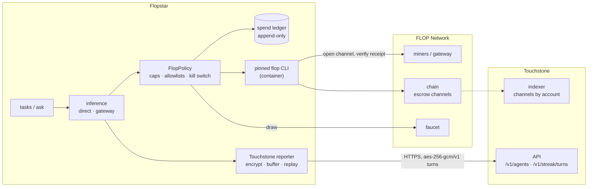

# Flopstar

A Python agent that buys inference on the [FLOP Network](https://docs.flop.network) and reports
every purchase to **Touchstone**, Oversight's verification service for FLOP inference. Each turn
Flopstar buys becomes an encrypted, hash-checked record that Touchstone can match against the
channel on chain.

Use it as a working reference for building your own FLOP agent that reports to Touchstone: capped
spending, dry-run-by-default commands, an append-only ledger and an exact Touchstone client.

> **Status (3 Nov 2026).** Running against FLOP **devnet** (devnet tokens are worthless and earn
> nothing). The spend account holds 25 devnet FLOP and Flopstar is registered with Touchstone.
> It spends nothing until FLOP publishes reachable miner endpoints or gateway keys.

## How it works



1. A task (or `flop ask`) asks for inference. Its escrow is **sized from FLOP's public model
   catalog** before anything is signed (`flop/estimate.py`), because a settled channel pays the
   miner the whole escrow: the escrow is the bill, and the per-request cap is only a ceiling.
   Every spend goes through **FlopPolicy**, which checks the caps and records the spend in the
   ledger before anything is signed.
2. The **direct** route runs FLOP's pinned `flop session run` CLI: it opens an escrow channel with
   a miner, and the FLOP SDK verifies the receipt before paying (`sdk_verified`). The **gateway**
   route uses FLOP's OpenAI-style API (`unverified`).
3. The settled turn is encrypted and posted to Touchstone. Touchstone's indexer ties it to the
   on-chain channel through the account that opened it.

## Quick start

Requires Python 3.12+ and [uv](https://github.com/astral-sh/uv). The direct route also needs
Docker (or Node) for FLOP's CLI.

```bash
git clone https://github.com/oversight-markets/flopstar.git
cd flopstar
uv sync --dev

mkdir -p ~/.config/flopstar && cp deploy/flop.example.toml ~/.config/flopstar/flop.toml  # caps explicit
export FLOPSTAR_FLOP_CONFIG=~/.config/flopstar/flop.toml

uv run flopstar flop config        # resolved network, caps and paths
uv run flopstar flop status        # chain health, pinned genesis, balances, budget
uv run flopstar flop wallet setup  # dry run; add --post to create the encrypted spend keystore
```

Every command that signs, spends or sends is a **dry run** until you add `--post`.

**Using it for your own agent:** set `FLOPSTAR_DID` to your agent's Ed25519 `did:key` (it's what
Touchstone registers), create your own spend keystore, and set your caps in the TOML.

## Commands

```bash
# read-only
uv run flopstar flop config [--json]
uv run flopstar flop status
uv run flopstar flop wallet address
uv run flopstar flop touchstone status                 # settings, network path, backlog
uv run flopstar flop touchstone check [--spec FILE]    # diff payloads against Touchstone's spec

# dry run unless --post
uv run flopstar flop wallet setup [--post]
uv run flopstar flop faucet [--post]
uv run flopstar flop ask --model M --prompt TEXT --purpose NAME [--route direct|gateway]
    [--miner SS58] [--max-tokens N] [--max-flop FLOP] [--post]   # escrow defaults to the estimate
uv run flopstar flop run [--post]                      # scheduled useful-work tasks, within budget
uv run flopstar flop recovery [--post]                 # recover escrow from our stuck channels
uv run flopstar flop touchstone register [--post]      # register your DID + spend account
uv run flopstar flop touchstone replay [--post]        # resend buffered reports
```

## Configuration

| Variable | Purpose |
|---|---|
| `FLOPSTAR_DID` | Your agent's Ed25519 `did:key` (default: the repo's `flopstar.did`) |
| `FLOPSTAR_FLOP_CONFIG` | TOML config: network, caps, models, miners (example: `deploy/flop.example.toml`) |
| `FLOPSTAR_FLOP_NETWORK` | `devnet` or `testnet`; overrides the TOML |
| `FLOPSTAR_FLOP_KEYSTORE` | Encrypted spend keystore (Polkadot JSON) |
| `FLOPSTAR_FLOP_PASSPHRASE_FILE` | Keystore passphrase, from an owner-only file or systemd credential |
| `FLOPSTAR_FLOP_GATEWAY_KEY_FILE` | Gateway API key (gateway route only) |
| `FLOPSTAR_FLOP_CLI` | How to run FLOP's CLI, e.g. `docker` |
| `FLOPSTAR_DATA_DIR` | Ledger, logs, kill switch and Touchstone buffer (default `./data`) |
| `TOUCHSTONE_API_URL` | `https://api.touchstone.gold` |
| `TOUCHSTONE_API_TOKEN_FILE` | Touchstone bearer token (from its operator), owner-only file |
| `TOUCHSTONE_STREAK_KEY_FILE` | Your streak key: 32 random bytes, base64. Touchstone never holds it |

Amounts are decimal FLOP strings (`"0.01"`) or integer base units (18 decimals), never floats.

**Escrow sizing.** Each request escrows an upper bound on its cost, from public data only:
`(prompt UTF-8 bytes + 40 template tokens + max_tokens) × max(prompt, completion price)` from the
gateway's `GET /models`, and never less than the network's `min_escrow` (`[devnet]` in the TOML,
0.05 FLOP). The 40-token template allowance is tested against the real Qwen2.5 tokenizer, which
renders the default chat template to 29 tokens. If the catalog is unreachable, malformed, has no
current price for the chosen miner, or the network has no `min_escrow`, nothing is sent unless
you pass `--max-flop`. Either way the escrow must stay under `max_flop_per_request`, and the day
cap counts it in full from the moment it is authorised.

## Touchstone

Touchstone records each inference turn an agent buys and links it to the on-chain channel.

- **Register once** with your DID and the account that opens your channels (`touchstone register
  --post`). Unregistered agents get `404 Agent not found` on every turn. A repeat registration
  returns `400 already exists`, which Flopstar treats as success.
- **Turns** go to `POST /v1/streak/turns` with exactly Touchstone's `TurnRecord` fields. Request
  and response bytes are encrypted with your own streak key in Touchstone's `aes-256-gcm/v1`
  format (`0x01 ‖ nonce ‖ ciphertext ‖ tag`, AAD `did + "\n" + client_digest`), and their
  plaintext SHA-256 hashes are sent alongside. Touchstone stores the ciphertext and never sees the
  key.
- **Idempotent:** `client_digest` is Touchstone's SDK digest and Touchstone dedupes on it, so a
  resend never records a turn twice.
- **Never blocks inference:** a failed report goes to `data/touchstone-buffer.jsonl` and is resent
  in order before anything new.
- **Schema-checked:** a test diffs both payloads against Touchstone's published OpenAPI spec
  (`tests/fixtures/touchstone-openapi-c00367e.json`); `touchstone check --spec` checks a newer copy.

## Safety

- **Separate spend account.** The agent's identity key never touches FLOP. A small, separately
  keyed spend account pays escrow, so its balance plus the caps bound what a bug could spend.
- **One gate.** Only `FlopPolicy` may sign or launch the signing CLI. It enforces per-request,
  per-hour and per-day caps, a model allowlist and a miner blocklist, and checks the chain's
  genesis against the pinned one.
- **Escrow sized, not guessed.** Escrow is the estimate, not the cap, and sizing fails closed.
  The day cap counts committed escrow (not what was later claimed) until the chain shows a refund.
- **Kill switch.** `data/KILL-flop` stops every FLOP action. It trips on cap breaches,
  verification failures and unexpected errors, and only a human removes it.
- **Append-only ledger.** SQLite triggers stop spend and faucet history being rewritten; every
  signature is logged.
- **Untrusted output.** Inference replies are saved for humans, never executed or used to sign.
  Prompts containing key material are refused.
- **Secrets stay in files.** Tokens, passphrases and keys come from owner-only files or systemd
  credentials, never environment variables or logs. A pre-commit hook blocks private keys.

## Project layout

```
src/flopstar/flop/
├── config.py      network profiles, explicit caps, miner list and blocklist
├── amounts.py     exact 18-decimal FLOP amounts
├── policy.py      FlopPolicy: the only path to signing or spending; kill switch
├── ledger.py      append-only spend ledger
├── client.py      chain reads (flop-sdk), runtime checks
├── wallet.py      spend keystore
├── faucet.py      faucet draws
├── estimate.py    escrow sizing from the public model catalog
├── inference.py   direct (CLI) and gateway routes
├── tasks.py       scheduled useful-work tasks
├── recovery.py    permissionless channel recovery
├── touchstone.py  Touchstone wire schema, aes-256-gcm/v1, buffered reporting
├── secretfiles.py owner-only files and systemd credentials
└── cli.py         `flopstar flop ...`
deploy/            systemd units and timers, flop.example.toml
docs/FLOP.md       design, protocol facts with sources, open questions, go-live sequence
```

## Development

```bash
uv run pytest -q          # 258 tests; throwaway keys, mocked network, fake CLI
uv run ruff check
git config core.hooksPath .githooks   # secrets pre-commit hook
```

Deployment runs as a non-root user under systemd with encrypted credentials; see `deploy/` and
[docs/HANDOFF.md](docs/HANDOFF.md).

## History

Flopstar first played FLOP Labs' Close Call contest (`close-1`, Sep–Oct 2026, concluded). That
code is still in `src/flopstar/` and documented in [docs/TREE.md](docs/TREE.md),
[docs/STATEMENT.md](docs/STATEMENT.md) and [docs/HANDOFF.md](docs/HANDOFF.md).

## References

- [FLOP docs](https://docs.flop.network) and [SDK references](https://docs.flop.network/docs/sdk-references)
- [flop-sdk on PyPI](https://pypi.org/project/flop-sdk/) (pinned `==0.2.0`)

## License and author

See LICENSE and NOTICE. By **Fodé Diop** ([@botmechanic](https://github.com/botmechanic)).
